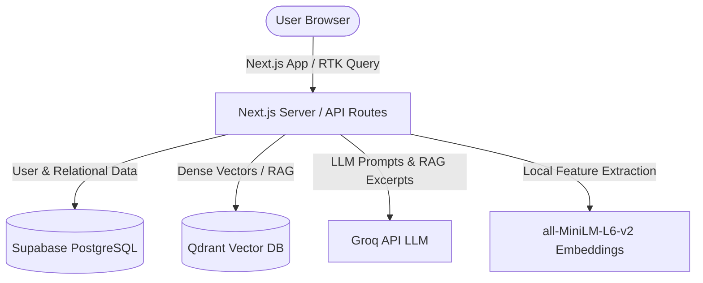

# ContentStore

**ContentStore** is an AI-powered personal content operating system designed to take content ideas from initial thought to published article and video script. It combines a relational database, vector search for semantic similarity and RAG, local embedding models, and high-speed LLM inference.

---

## 🚀 Tech Stack & What We Use

| Technology | Purpose | Where & How It Is Used |
| :--- | :--- | :--- |
| **Next.js 16 (App Router)** | Framework & API | Full-stack application: React 19 UI, server components, and route handlers under `/api`. |
| **Supabase (PostgreSQL + Auth)** | Primary Database & Auth | Stores users, ideas, research chat history, and custom prompt templates with Row Level Security (RLS). |
| **Qdrant (Vector Database)** | Semantic Vector Search | Cloud or local vector engine for duplicate idea detection and semantic search over research notes & PDFs. |
| **@xenova/transformers** | Local Vector Embeddings | Computes 384-dimensional cosine embeddings (`Xenova/all-MiniLM-L6-v2`) inside the server environment without external embedding API costs. |
| **Groq API** | Ultra-Fast LLM Inference | Runs `openai/gpt-oss-120b` / `llama-3.3-70b` for RAG research answers, article drafting, prompt rewriting, and AI prompt enhancement. |
| **unpdf** | PDF Text Extraction | Serverless-compatible PDF parser that extracts text from uploaded research papers and notes. |
| **Redux Toolkit & RTK Query** | State Management & Cache | Manages client-side state, API caching, and tag invalidation for ideas, research, and prompt templates. |
| **Tailwind CSS v4 & Lucide** | Design System & UI | Dark/light theme, micro-animations, glassmorphism, responsive modals, and modern design tokens. |

---

## 🛠️ How Everything Works

### 1. User Authentication & Multi-Tenancy (Supabase)
* **Auth Flow**: Users register and sign in at `/signup` and `/login` using Supabase Auth.
* **Session Management**: Session cookies are maintained on the server via `@supabase/ssr`.
* **Route Protection**: Next.js middleware ([`src/middleware.ts`](./src/middleware.ts)) verifies user sessions on every request and redirects unauthenticated users to `/login`.
* **Data Isolation**: Row Level Security (RLS) policies ensure that users can only select, insert, update, and delete their own ideas, messages, and prompts.

---

### 2. Idea Creation & Semantic Scan (`/ideas/new`)
* When starting a new idea, the user enters a proposed title.
* **Scan through ideas**:
  1. The title is converted into a 384-dimensional vector using `all-MiniLM-L6-v2`.
  2. The vector is queried against Qdrant's `ideas` collection.
  3. Qdrant returns the 3 most semantically similar existing ideas.
* If a similar idea exists, the user can jump straight into it to avoid duplicate work.
* If it's a new idea, it is saved into Supabase (`public.ideas`) and its vector is indexed in Qdrant.

---

### 3. Research Assistant & RAG Chat (`/ideas/[ideaId]`)
Each idea has an integrated research assistant powered by Retrieval-Augmented Generation (RAG):
* **Adding Context**:
  * **Upload PDF**: Processed server-side with `unpdf`, chunked into overlapping sections, embedded, and stored in Qdrant's `research` collection.
  * **Paste Text**: Long notes are chunked and indexed into Qdrant similarly.
* **Asking Questions**:
  * When a question is asked, the query is embedded and matched against Qdrant vectors for that specific `ideaId`.
  * Top matching excerpts are passed to Groq as verified context.
  * Groq generates concise, direct answers strictly grounded in your sources.
  * The conversation history is persisted in Supabase (`public.research_messages`).

---

### 4. Article Generation & Prompt Enhancement
* **Generate Article**: Clicking *Generate Article* takes the full research conversation transcript and prompts Groq to draft a cohesive long-form article.
* **Use a Prompt**: Users can select from custom prompt templates (e.g., *"Make it punchy"*, *"Technical breakdown"*, *"Storytelling hook"*). Groq rewrites the draft according to the prompt instructions.
* **Enhance Prompt with AI**: While editing or creating prompts in `/prompts`, users can click *Enhance with AI* to have Groq optimize the prompt instructions for maximum clarity and output quality.

---

### 5. Video Script & Teleprompter
* **Script Editor**: Dedicated workspace for drafting YouTube and Instagram scripts (`youtubeScript`).
* **Full-Screen Teleprompter**:
  * Variable auto-scroll speed controls.
  * Adjustable font size and eye line indicator.
  * Text mirroring mode for physical teleprompter glass rigs.
  * Built-in rehearsal timer to time your speech.

---

### 6. Prompts Library (`/prompts`)
* Centralized library for reusable writing templates.
* Search, filter, duplicate, and organize prompts into categories.
* Stored in Supabase (`public.prompts`) with user ownership.

---

## 🗄️ Where Data Lives



| Data Type | Primary Store | Details |
| :--- | :--- | :--- |
| **User Accounts** | Supabase Auth | `auth.users` |
| **Ideas & Metadata** | Supabase DB | `public.ideas` (title, status, draft, script, eligibility flags) |
| **Research Messages** | Supabase DB | `public.research_messages` (chats, uploaded source references) |
| **Custom Prompts** | Supabase DB | `public.prompts` (prompt templates and titles) |
| **Similar Idea Vectors** | Qdrant | Collection: `ideas` (384-d vectors, cosine distance) |
| **Research Context Chunks** | Qdrant | Collection: `research` (payload indexed on `ideaId`, `sourceKey`, `sourceName`) |

---

## ⚙️ Environment Variables

Create a `.env.local` file in the root directory:

```env
# Vector Database (Qdrant Cloud or Local)
QDRANT_URL="https://<your-cluster>.qdrant.io"
QDRANT_API_KEY="<your-qdrant-api-key>"

# Groq LLM Inference
GROQ_API_KEY="gsk_..."
GROQ_MODEL="openai/gpt-oss-120b"   # or llama-3.3-70b-versatile

# Supabase Authentication & Database
NEXT_PUBLIC_SUPABASE_URL="https://<your-project-ref>.supabase.co"
NEXT_PUBLIC_SUPABASE_ANON_KEY="<your-supabase-anon-key>"
```

---

## 🏃 Getting Started

### 1. Database Setup (Supabase)
1. Open your project in the [Supabase Dashboard](https://supabase.com).
2. Go to the **SQL Editor**.
3. Run the schema file located in [`supabase/schema.sql`](./supabase/schema.sql).
4. In **Authentication** $\rightarrow$ **URL Configuration**, set:
   * **Site URL**: `http://localhost:3000` (or your production URL)
   * **Redirect URLs**: `http://localhost:3000/auth/callback`

### 2. Vector Database Setup (Qdrant)
You can use **Qdrant Cloud** (recommended) or run locally with Docker:
```bash
docker compose up -d
```
*(Default local endpoint: `http://localhost:6333`)*

### 3. Install Dependencies & Run
```bash
npm install
npm run dev
```
Open [http://localhost:3000](http://localhost:3000) and create an account via `/signup`.

---

## 📦 Deployment (Vercel)

1. Connect your repository to **Vercel**.
2. Add all environment variables from `.env.local` into the Vercel project settings.
3. Update Supabase **Redirect URLs** to include your production domain: `https://your-domain.vercel.app/auth/callback`.
4. Deploy! The project includes automatic `outputFileTracingIncludes` in [`next.config.ts`](./next.config.ts) to bundle native ONNX Linux binaries on Vercel serverless functions without configuration.
